# 医院月度绩效核算与人员管理操作指南

> **版本**：v1.1　　**更新日期**：2026-10-29
> **适用系统**：大连市皮肤病医院绩效管理系统
> **适用对象**：绩效管理员、科室负责人、普通职工

---

## 阅读指引

- **第一次使用**：先看第一章，了解系统能做什么、自己属于哪类角色、能看什么、能改什么。
- **每月做核算**：按第二章六个阶段的顺序推进：数据同步 → 基础数据维护 → 生成核算表 → 科室确认与期间结账 → 二次分配填报 → 结果分析。
- **只想查某个功能怎么点**：直接翻第三章，按"绩效管理员 / 科室负责人 / 普通职工"找对应条目。
- **遇到报错或结果异常**：先看第四章 Q&A；仍然解决不了，按 4.5 的联系方式找人。
- **菜单找不到**：用系统右上角的搜索框直接搜菜单名。

---

# 第一章 系统概述与角色分工

## 1.1 系统定位

本系统是医院绩效核算与分配管理系统：从 HIS 等业务系统获取原始业务数据，按医院绩效方案完成「一次分配（医院 → 核算单元）— 二次分配（核算单元 → 员工）」的月度核算，并支持科室确认、期间结账、审核与结果分析。

- 核算周期：自然月（账期 = 核算年份 + 核算月份）
- 核算层级：一次分配（核算单元/科室）→ 二次分配（科室到员工）
- 数据方向：**只从其他系统取数**，不向其他系统回写、不下发数据
- 结果去向：系统内展示与导出（Excel）；**不涉及实际发放**（发放是线下业务），**未对接财务系统**

## 1.2 两类使用者

| 角色 | 典型岗位 | 核心诉求 | 使用频率 |
|---|---|---|---|
| 绩效管理员 | 绩效办、财务、运营 | 取数、算全院的账、审核发布、二次分配审核、分配权限 | 每月集中使用 |
| 科室负责人 | 科主任、护士长 | 确认本科室核算表、查看本科室结果、填二次分配 | 每月 1–2 次 |
| 普通职工 | 医生、护士、医技、行政 | 查看本人绩效明细 | 每月 1 次 |

## 1.3 权限边界

> 原则：**谁能看、谁能改、谁能发**三件事分开；数据权限按核算单元隔离，不按菜单隔离。

| 能力 | 绩效管理员 | 科室负责人 | 普通职工 |
|---|---|---|---|
| 查看全院绩效汇总 | ✅ | ❌ | ❌ |
| 查看本科室绩效明细 | ✅ | ✅（仅授权科室） | ❌ |
| 查看本人绩效明细 | ✅ | ✅ | ✅ |
| 维护基础档案（科室/人员/系数） | ✅ | ✅（可按需授权，不建议） | ❌ |
| 配置医技护执行比例 | ✅ | ❌ | ❌ |
| 生成核算表 / 重算 | ✅ | ❌ | ❌ |
| 下发到科室 | ✅ | ❌ | ❌ |
| 确认本科室核算表 | ❌ | ✅（仅授权科室） | ❌ |
| 期间结账 | ✅ | ❌ | ❌ |
| 异常数据审计与修正 | ✅ | ❌ | ❌ |
| 二次分配额度填报 | ❌（可查看全局进度） | ✅（仅授权科室） | ❌ |
| 二次分配审核 / 退回 / 撤销审核 | ✅（当前仅管理员，可按配置下放） | ❌ | ❌ |
| 查看绩效分析报表 | ✅（全院） | ✅（本单元） | ✅（仅二次分配结算分析·本人） |
| 角色与权限分配 | ✅ | ❌ | ❌ |

**补充说明**：

- 授权科室来源：`基础服务 / 科室管理` 的「负责人」列；维护了谁，谁就能看到对应核算单元（详见 2.4）。
- 超管账号：**拥有所有权限**（不受科室数据权限限制）。
- 离职 / 停用：员工管理中维护离职信息，用户管理中停用账号（见 1.4.4）。

## 1.4 账号与角色

> 账号与角色一般由**绩效管理员**统一维护，通常不下放给科室；确需下放时，按系统配置分配对应菜单权限即可。

### 1.4.1 添加员工并自动生成账号

1. 进入 `基础服务 / 员工管理`；
2. 点右上角【新增】，填写员工基本信息；
3. 关键字段**人员编码**：一般填医院 OA 工号或医院习惯使用的编号；
4. 保存后，系统按人员编码同步生成登录账号，员工凭该账号登录。

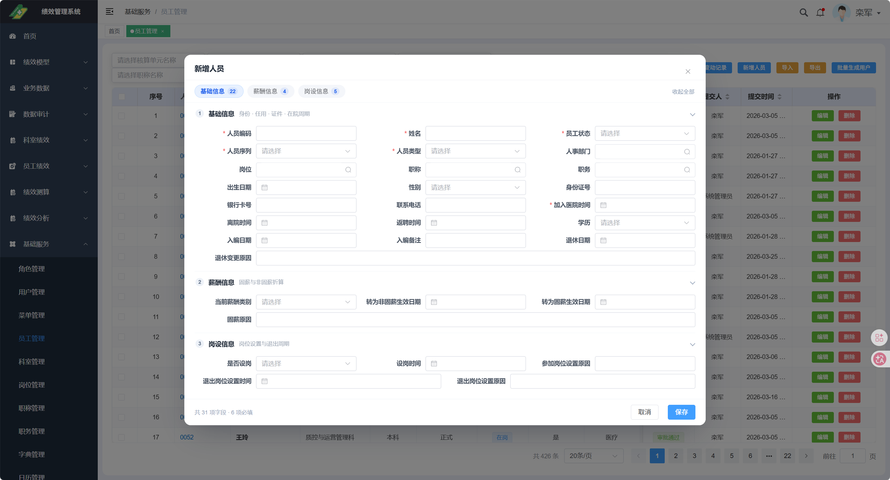

> 人员编码既是员工档案的主键口径，也是登录账号来源，填错会影响后续工号对照与绩效归属。

### 1.4.2 查看账号与重置密码

- `基础服务 / 用户管理` 可看到所有同步生成的账号：用户名、账号、人员类型、关联员工、分配角色、状态。
- **重置密码**：用户管理列表 → 目标用户【更多】→【重置密码】。
- **修改自己的密码**：点右上角头像 →【修改密码】。

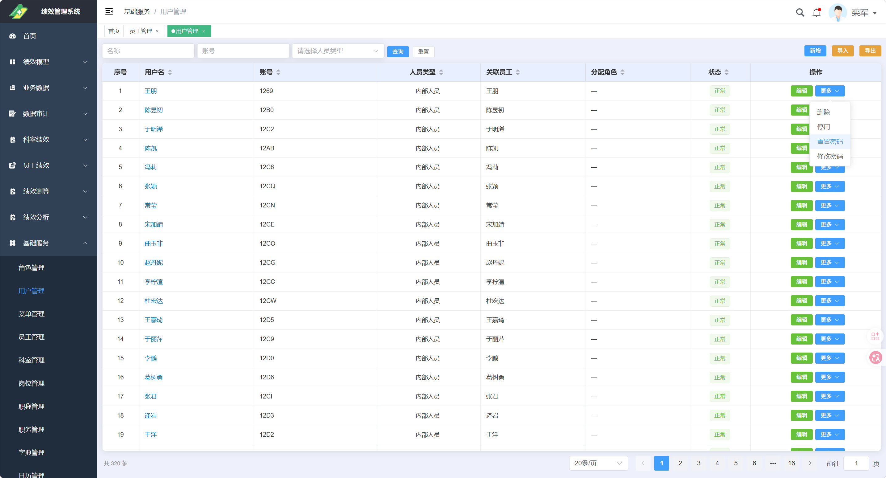
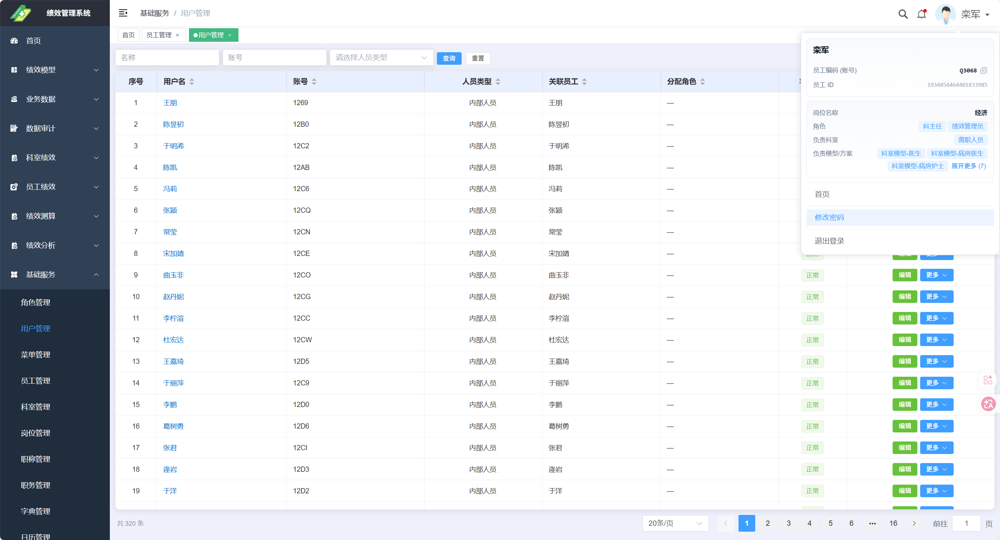

### 1.4.3 角色与权限配置

1. 进入 `基础服务 / 角色管理`，可看到现有角色（编码、名称、描述），也可【新增】；
2. 点【编辑】进入配置：
   - **权限**：勾选该角色可见的菜单与按钮（这就是"功能权限"）；
   - **关联科室**：按需绑定；
   - **用户**：在弹窗下方维护"哪些人属于这个角色"。
3. **一个人可以同时拥有多个角色**，权限取并集。

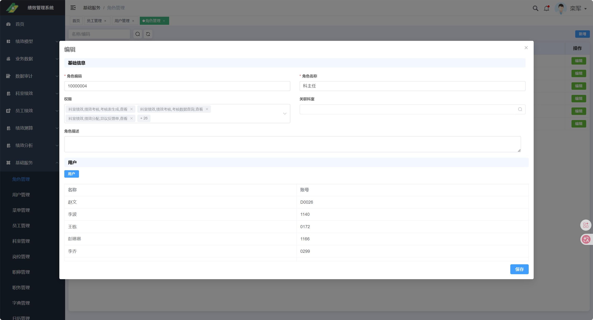

### 1.4.4 离职与停用

离职通常分两步处理：

1. **员工管理**：`基础服务 / 员工管理` 编辑该员工信息，维护离职相关属性（员工状态、离院时间等）；
2. **用户管理**：`基础服务 / 用户管理` → 目标账号【更多】→【停用】，停用后该账号不能登录。

- 账号只是**登录与权限的载体**，员工才是业务主体；停用账号不影响历史绩效。
- 即使员工档案被删除，系统对核算结果做了快照，**绩效核算数据始终保留**。

---

# 第二章 月度绩效核算全景流程

## 2.0 流程总览

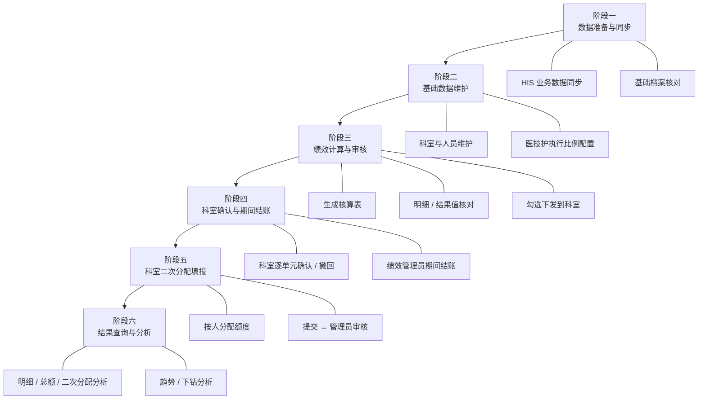

> 时间上不设固定日期：到了次月、上月数据能取到，即可开始核算；具体节奏见 2.7。

## 2.1 阶段一：数据准备与同步

| 项 | 内容 |
|---|---|
| 操作人 | 绩效管理员 |
| 入口 | `业务数据 / 原始数据` |
| 数据来源 | 第三方系统（本期主要对接 HIS） |
| 同步方式 | 每晚自动同步，同步范围为上月整月数据 |
| 完成标志 | 「拉取状态」全部成功 |

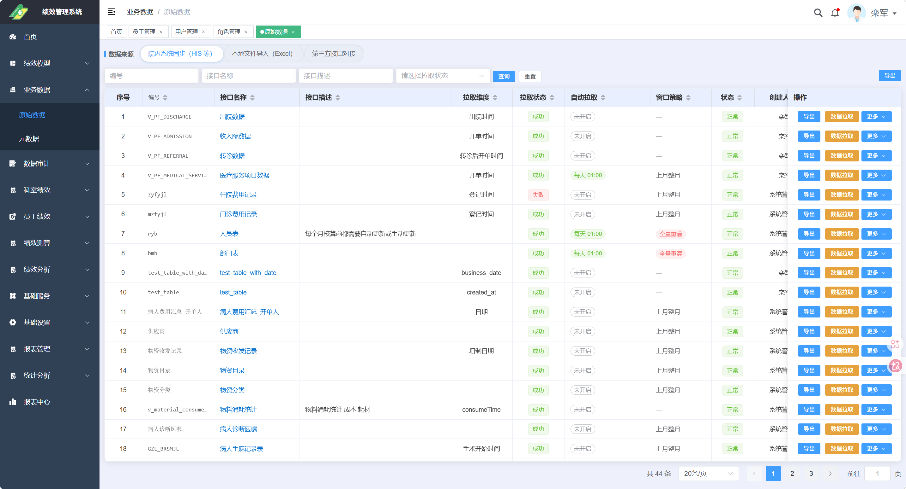

**操作步骤**

| # | 操作 | 入口 | 填写/选择 | 注意事项 |
|---|---|---|---|---|
| 1 | 查看自动同步结果 | 业务数据 / 原始数据 | — | 一般无需人工触发，系统每晚自动同步上月整月数据 |
| 2 | 核对拉取状态 | 同上 | — | 状态显示成功即可；失败处理见下方 |
| 3 | （可选）抽查重点表条数 | 同上 | 按表查看 | 一般只需看拉取状态；如需进一步确认，再与上月或业务量对比 |
| 4 | 手动补拉（失败时） | 同上，点击【数据拉取】 | 选择数据表 / 时间范围（按系统配置） | 自动同步失败时使用；补拉后重新确认拉取状态 |

**本期重点对接的 HIS 数据表**

| # | 数据表 | 说明 |
|---|---|---|
| 1 | 出院数据 | 出院人次及出院结算相关数据 |
| 2 | 收入院数据 | 入院 / 收入院记录 |
| 3 | 转诊数据 | 转诊记录 |
| 4 | 医疗服务项目数据 | 收费项目明细 |
| 5 | 人员表 | 员工基础信息 |
| 6 | 部门表 | 科室 / 部门基础信息 |

> 以上 6 张表是本期绩效核算的基础数据源；其余接口表按实际使用情况查看即可。

**注意事项**

- 同步是自动的，正常情况下不需要每天盯，**月初确认一次「拉取状态」**即可。
- 自动同步失败时，在「业务数据 / 原始数据」页面用【数据拉取】按钮**手动补拉**，补拉后再确认状态。
- 手动补拉的范围由系统配置：数据量小或关键表一般为**全量拉取**（点【数据拉取】即全部）；带时间范围的表按配置选择时间范围。
- 拉取是**幂等**的：拉到什么数据，就先清理对应数据再写入；**拉不到时不会擅自清理**已有数据。
- 跨月补录：通过选择对应时间范围补拉即可。
- 「拉取状态」取值：成功 / 失败 / 同步中。

## 2.2 阶段二：基础数据维护

| 项 | 内容 |
|---|---|
| 操作人 | 绩效管理员 |
| 入口 | `业务数据 / 原始数据` → 页签【本地文件导入（Excel）】→ 点击接口名称 |
| 维护方式 | 详情页右上角【单行新增】【更新导入】【全量覆盖】【导出】；行内【编辑】【复制】【删除】 |
| 完成标志 | 当月需要维护的表均已处理，数据核对无误 |

**进入方式**

`业务数据 / 原始数据` 页面有三个页签：`院内系统同步（HIS 等）`、`本地文件导入（Excel）`、`第三方接口对接`。手工维护的数据都在**第二个页签**：点目标表的**接口名称**进入详情，右上角就是新增 / 导入 / 导出按钮，行尾是编辑 / 复制 / 删除。

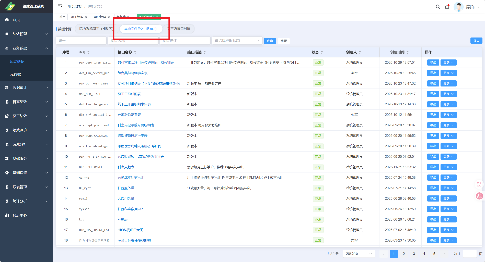
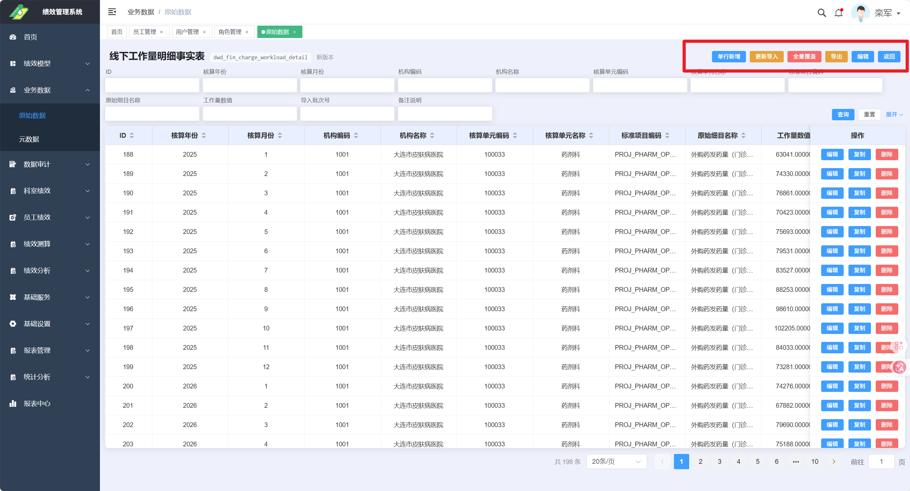

**录入与导入方式（系统实际按钮）**

| 按钮 | 行为 | 适用场景 |
|---|---|---|
| 单行新增 | 在页面上逐行添加一条记录 | 少量补录、临时新增 |
| 更新导入 | 按 **ID** 匹配更新；**ID 为空则新增** | 既有数据修订 + 少量新增，日常首选 |
| 全量覆盖 | **先清空整张表，再导入** | 整月数据重录、彻底重置 |

> ⚠️ 「全量覆盖」会清空整表，执行前务必确认数据已备份；导入完成后抽查条数，避免"导空"。

**月度维护清单**

| # | 数据表 | 业务用途 | 维护频率 | 维护方式 | 备注 |
|---|---|---|---|---|---|
| 1 | 各科室收费项目医技护执行划分维表 | 各科室收费项目的医技护执行比例划分 | 按需（比例调整时） | 新增 / 编辑 / 导入 | 由各科室按实际情况提供，不做合计限制 |
| 2 | 综合奖惩明细事实表 | 奖励 / 惩罚 / 扣款原始明细 | 有奖惩才录 | 新增 / 编辑 / 删除 / 导入 | 当月无奖惩可不录 |
| 3 | 院外项目维护表 | 登记不参与绩效核算的院外项目清单 | 有新院外项目时 | 新增 / 导入 | 院外项目不参与绩效核算 |
| 4 | 员工工号对照表 | HIS 工号 / 员工编码 与 医院 OA 编码对照 | 有新员工时 | 新增 / 导入 | 标准编码须与员工管理一致 |
| 5 | 线下工作量明细事实表 | 承载 HIS 中没有的工作量 | 每月 | 导入 | 药剂科、收款处等 |
| 6 | 专项激励配置表 | 配置项目的专项激励标准 | 需要时 | 新增 / 编辑 | 金额与起止日期按医院实际 |
| 7 | 科室岗位系数月度明细表 | 员工所属科室 / 核算单元、岗位系数、在岗天数 | **每月必配** | 导入 / 编辑 | 决定二次分配默认人员 |
| 8 | 绩效核算日历维度表 | 工作日 / 节假日 / 日期类型 | 一年一次 | 新增 / 导入 | 2026 年已录完，下次录 2027 年 |
| 9 | 中医优势病种入组患者明细表 | 中医优势病种入组患者明细 | 每月 | 导入 | 本质属线下工作量，单独建表 |
| 10 | 医院收费项目绩效点数版本维表 | 收费项目的绩效点数（RVU）版本 | 定稿后半年至一年 | 新增 / 编辑 | 不轻易调整，需要时再动 |

**逐表说明**

1. **各科室收费项目医技护执行划分维表**
   - 作用：一个收费项目如果是医生、护士、技师共同完成的，用这张表约定各自承担的比例（如医生 60%、护士 30%、技师 10%）；没参与的角色填 0。
   - 维护时机：科室开展新项目、执行比例调整时维护，不是每月必动。
   - 数据来源：由各科室根据实际情况提供，**提供什么就导入什么，系统不做合计限制**。

2. **综合奖惩明细事实表**
   - 作用：登记奖励、惩罚、扣款的原始明细，关键信息是「核算单元 / 员工 + 金额 + 奖还是惩」。
   - 维护时机：**当月有奖惩就录，没有就不录**。
   - 填写规则：
     - **核算单元（科室）必填**；
     - 能确定到具体某个人 → 填员工，即个人奖惩；
     - 不能确定到人、只能确定到科室 → 员工留空，即科室整体奖惩。
   - 奖惩大类 / 项目编码：**自由填报**，主要服务于分析统计；填了什么，分析时就按什么维度归类，对核算本身影响不大。
   - 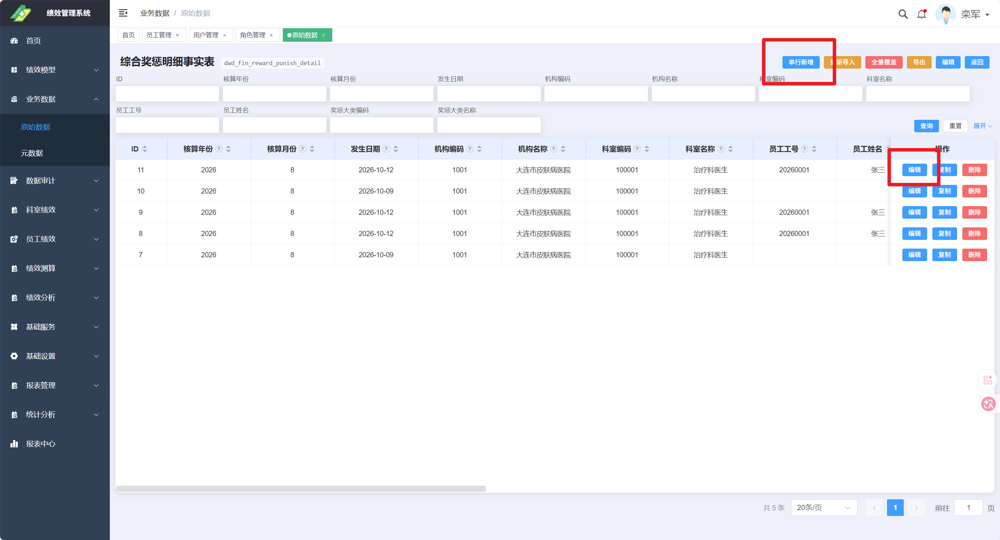

3. **院外项目维护表**
   - 作用：医院按自身情况认定哪些收费项目属于「院外项目」；**列入本表的项目不参与绩效核算**。
   - 维护时机：出现新的院外项目时补充。
   - 注意：没有列入的项目会正常参与核算，所以医院不希望参与核算的项目一定要在这里登记。

4. **员工工号对照表**
   - 作用：HIS 人员数据里带的是 **HIS 工号 / 姓名**（原系统工号、原系统姓名），医院实际使用的是另一套 **OA 编码**（标准人员编码）。本表负责两套编码的对照。
   - 字段：来源机构、来源系统（如 HIS）、原系统工号 / 姓名、标准人员编码 / 姓名、逻辑开关。
   - 维护时机：**有新员工时维护，没有新员工就不用动**。
   - 注意：**标准人员编码必须与「员工管理」里的工号保持一致**，否则数据对不上人。
   - 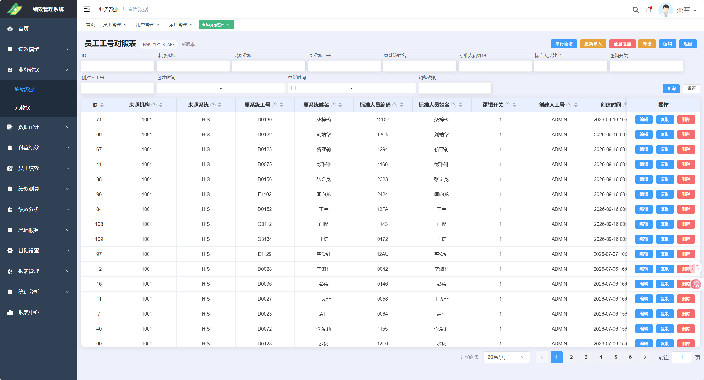

5. **线下工作量明细事实表**
   - 作用：承载 HIS 没有覆盖的工作量；**本项目主要用于药剂科、收款处**。
   - 数据来源：医院从其他系统导出报表，格式基本与本系统模板对齐，稍作整理、补齐年份 / 月份等字段即可导入。
   - 维护时机：**每月导入一次**。
   - 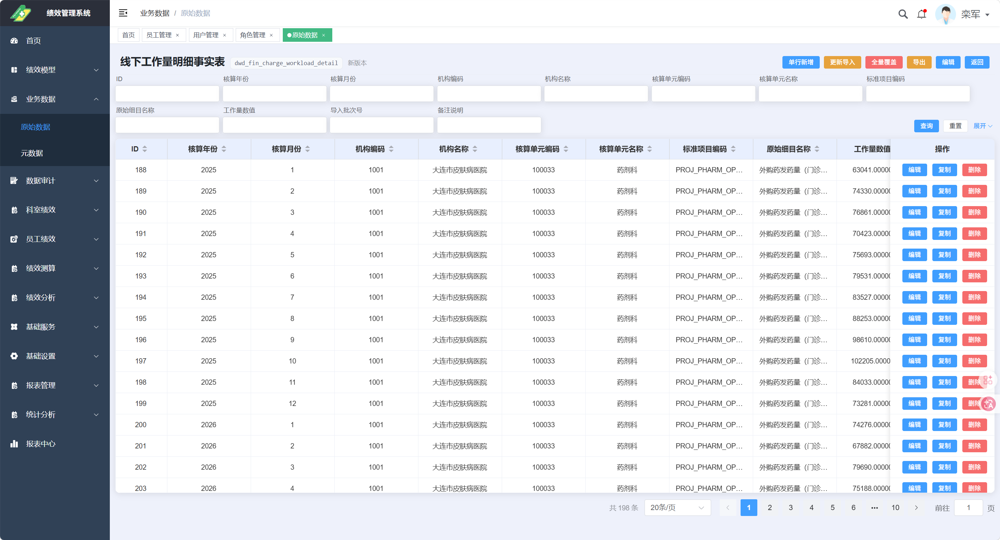

6. **专项激励配置表**
   - 作用：对特定收费项目配置专项激励金额。
   - 填写规则：**金额标准按医院自定**；生效日期 / 失效日期表示该时间段内按此标准激励。
   - 维护时机：**需要专项激励时才配置**，没有就不配。
   - 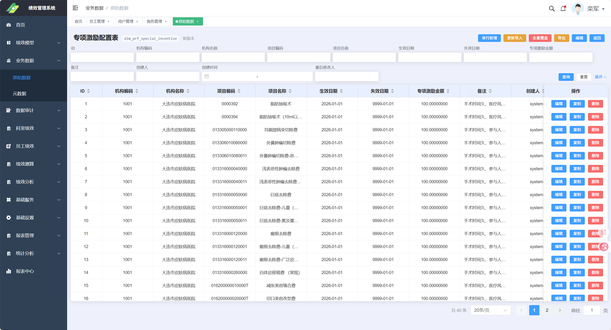

7. **科室岗位系数月度明细表**
   - 作用：记录每月每名员工在哪个核算单元、岗位系数是多少、在岗多少天。
   - 一人多单元：按实际天数拆分，例如同时在两个核算单元、基本平分，就各写 10 天；系数没有特殊要求时保持一致（都写 1）即可。
   - **关键影响**：
     - **二次分配默认发给哪些人，主要来自这张表**（负责人可以再手动添加其他人，但默认名单看这里）；
     - 指标归口 / 审查也按"人当月所在核算单元"认定；`员工管理` 是静态表、没有历史，历史归属以本表为准。
   - 维护时机：**每月都需要配置**，是核算的核心输入。
   - 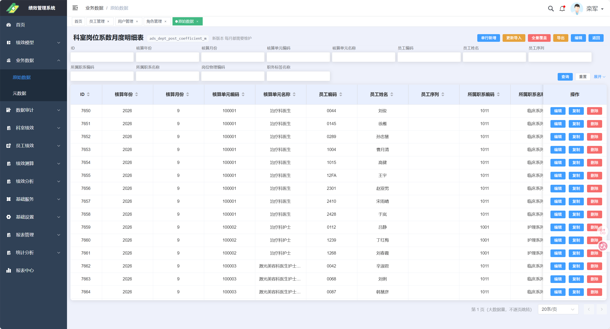

8. **绩效核算日历维度表**
   - 作用：**每天一行**，定义日期类型与系数，供按日核算的指标使用。
   - 维护规则：按国家节假日 / 医院政策维护；重点在**系数**——某些核算项在周末、节假日系数不同，想给哪天配什么系数就配哪天。
   - 维护时机：**一般一年录一次**；2026 年已录完，下一次录 2027 年。
   - 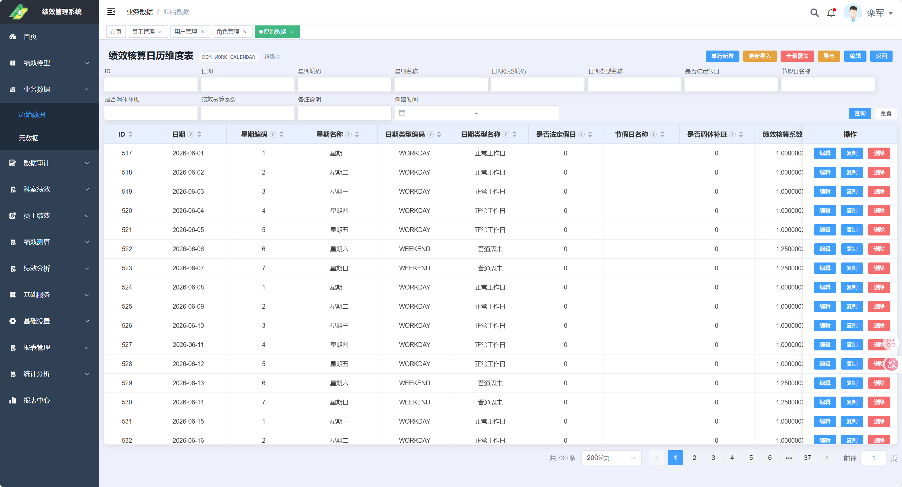

9. **中医优势病种入组患者明细表**
   - 作用：本质属于**线下工作量**，因数据结构与常规工作量不同，单独用一张表承载。
   - 数据来源：医院相关系统导出报表，整理后导入即可；没有额外的"入组判定 / 点数关联"规则。
   - 维护时机：**每月导入**，属于原始基础数据。
   - 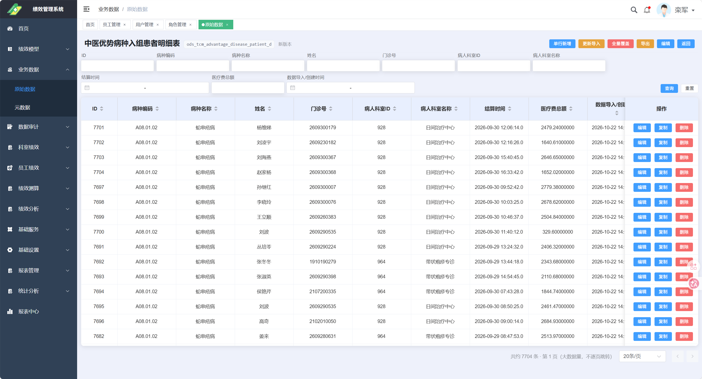

10. **医院收费项目绩效点数版本维表**
    - 作用：维护收费项目的绩效点数（RVU）。
    - 版本号：只是**标注 / 备注**，系统不存在自动切版本；一般不改，确需大改时提前备份，次年大改就升一个版本号。
    - 维护时机：**一般不轻易调整**，定稿后通常执行半年到一年。
    - 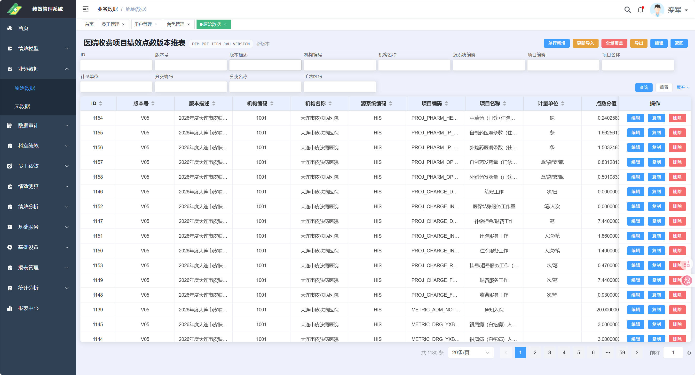

**注意事项**

- 所有核算都基于这些基础数据与原始数据：**改了数据又重新核算，结果大概率会变；不重新核算，结果保持不变**。改数据通常意味着原数据有误，应重新核算。
- 各表入口统一：`业务数据 / 原始数据 → 本地文件导入（Excel）` → 点接口名称进详情。
- 不是每张表都必须每月动：奖惩、专项激励、工号对照、院外项目按业务发生情况维护；**岗位系数表每月必配**；日历一年一次；点数版本定稿后长期稳定。

## 2.3 阶段三：绩效计算与审核

| 项 | 内容 |
|---|---|
| 操作人 | 绩效管理员 |
| 入口 | `科室绩效 / 绩效分配 / 科室核算表生成` |
| 完成标志 | 目标账期「生成状态」= **成功**，明细核对无误且已下发到科室 |

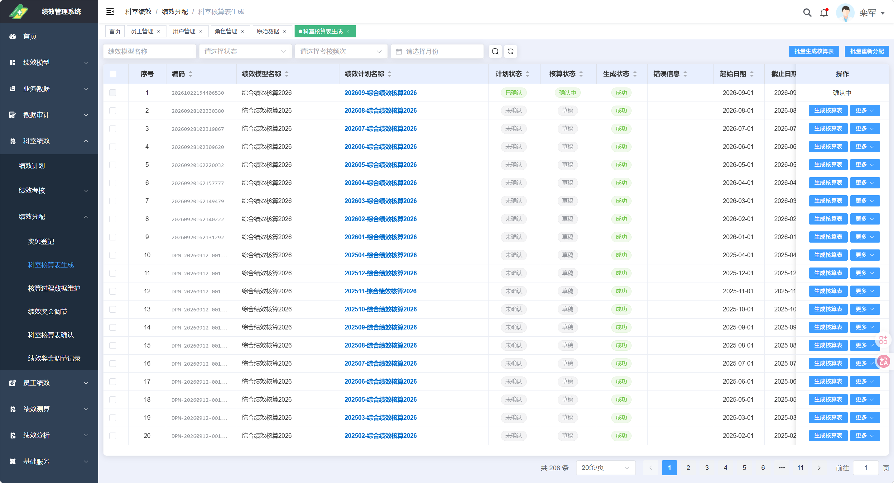

**操作步骤**

| # | 操作 | 入口 | 填写/选择 | 注意事项 |
|---|---|---|---|---|
| 1 | 进入核算表生成列表 | 科室绩效 / 绩效分配 / 科室核算表生成 | — | 顶部可按绩效模型名称、状态、考核频次、月份筛选 |
| 2 | 定位目标账期 | 同上 | 按起始 / 截止日期或绩效计划名称 | 确认起止日期与目标账期一致（如 2026-09-01 ~ 2026-09-30） |
| 3 | 生成核算表 | 目标行【生成核算表】 | — | 点击后等待「生成状态」变为**成功**；失败看「错误信息」列 |
| 4 | 进入详情 | 点击「绩效计划名称」 | — | 详情页分「基本信息」「明细」两个页签 |
| 5 | 核对分单元结果 | 明细页签 | — | 「组织名称」即核算单元；逐列核对各核算项积分与合计行 |
| 6 | 查看计算过程 | 点击「结果值」 | — | 弹窗含「原始数据（全量）/ 精简预览」、计算过程描述、明细 JSON，可【显示全部字段】 |
| 7 | 勾选并下发 | 明细页勾选核算单元 →【下发到科室】 | 勾选要下发的核算单元 | **下发前科室看不见，下发后才可见** |
| 8 | （可选）取消下发 | 【取消下发】 | — | 下发后发现数据不对、不想让负责人看到时使用；取消后该核算单元负责人**立即看不到**结果 |

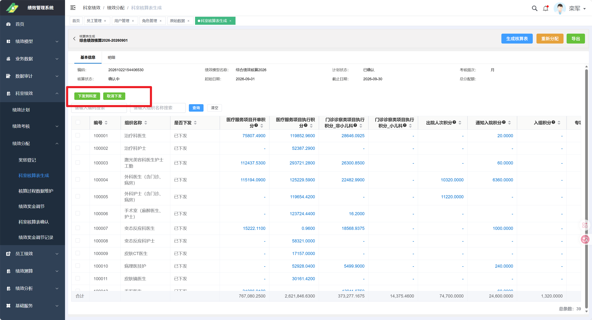
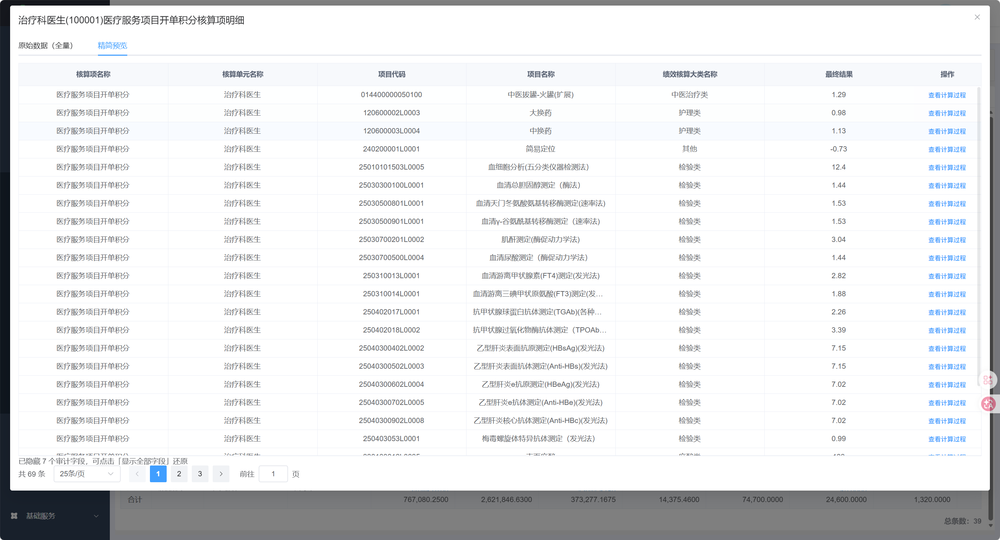

**批量生成核算表（补算多个月时用）**

- 勾选列表左侧复选框选中多个账期 → 右上角【批量生成核算表】，一次性把多个月分别算出来。
- 适用场景：医院几个月一发（如中间停了 3–5 个月），需要把积压账期一次补齐。
- **日常按月核算直接点行末【生成核算表】即可，不需要用批量**。

**关键说明**

- **生成状态 = 成功**只代表核算表已生成，**是否下发是另一个动作**；列表与详情页均有「是否下发」标识（已下发 / 未下发）。
- 点击「结果值」可追溯到该单元该核算项的原始数据与计算过程，核对时优先看：合计行、异常大额/负数、与上月差异。
- 生成失败时先看「错误信息」列，再按第四章 Q1 / Q2 排查。
- **重新生成**：重算后一次分配结果会变化，**已下发的也会随之变化**；通常先【取消下发】，再重新生成，核对无误后重新下发。

**注意事项**

- 本方案顺序固定：一次分配生成核算表 → 下发 → 科室确认 → 期间结账，之后才有二次分配的依据。
- 重复生成是**重算**，不会翻倍或叠加。
- 下发后，科室在 `科室绩效 / 绩效分配 / 科室核算表确认` 查看结果。

## 2.4 阶段四：科室确认与期间结账

| 项 | 内容 |
|---|---|
| 操作人 | 科室负责人（确认）；绩效管理员（期间结账） |
| 入口 | `科室绩效 / 绩效分配 / 科室核算表确认` |
| 数据权限 | 只能看到自己负责的核算单元（负责人维护在 `基础服务 / 科室管理`） |
| 完成标志 | 列表显示「全部已确认」；管理员完成【期间结账】，该账期一次分配结果定稿 |
| 确认状态 | 草稿 → 确认中 → **全部已确认**（列表「核算状态」列实时反映） |

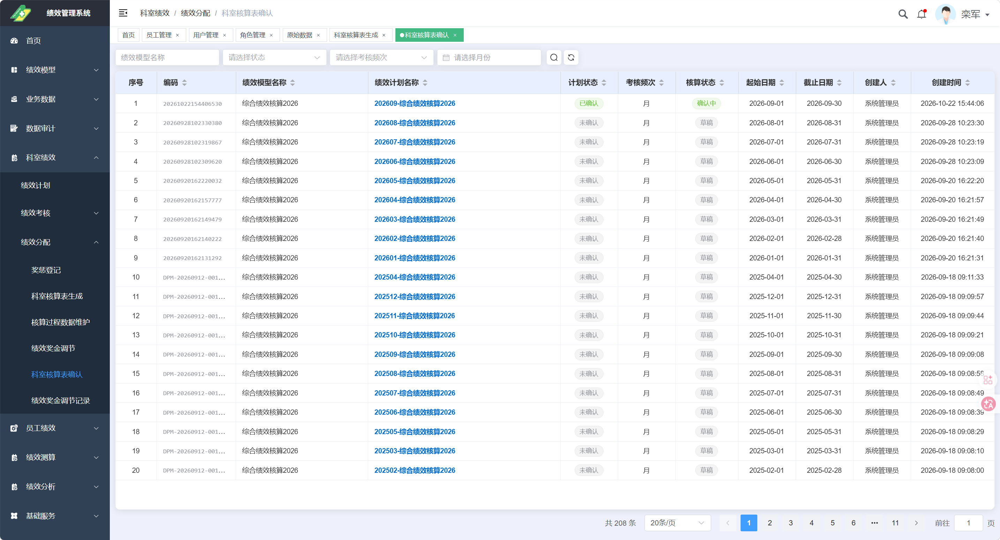
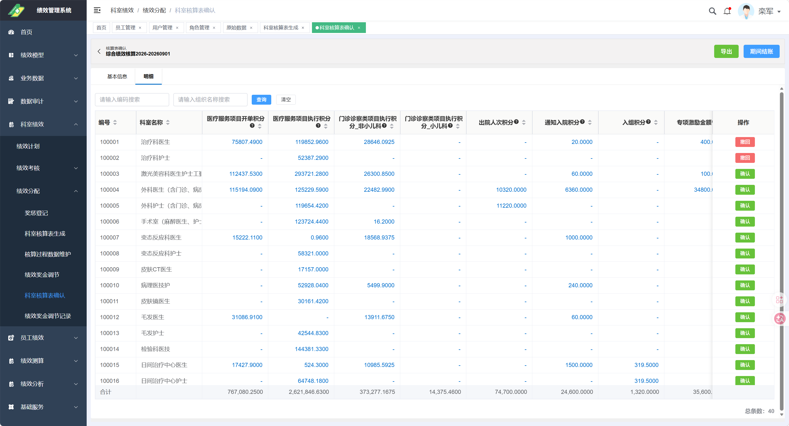
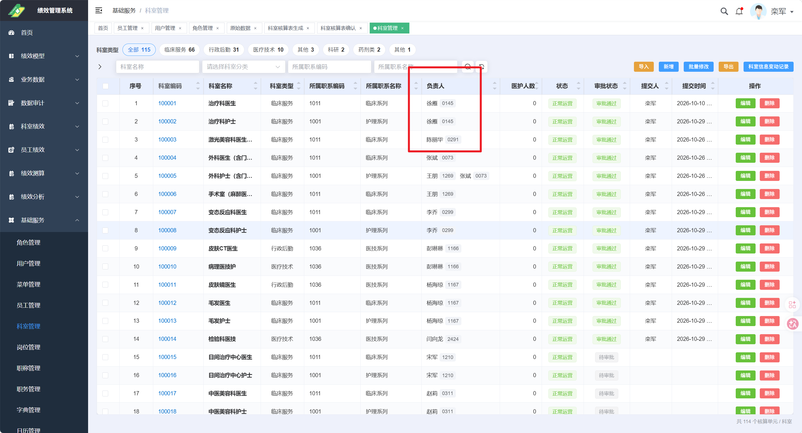

**操作步骤（科室确认）**

| # | 操作 | 入口 | 填写/选择 | 注意事项 |
|---|---|---|---|---|
| 1 | 进入核算表确认 | 科室绩效 / 绩效分配 / 科室核算表确认 | — | 科室账号进入；**只能看到自己负责的核算单元** |
| 2 | 选择账期并进入详情 | 点击「绩效计划名称」 | 按年月 / 计划筛选 | 详情页分「基本信息」「明细」两个页签 |
| 3 | 核对数据 | 明细页签 | — | 点击任意数值即可查看该核算项的计算过程 |
| 4 | 逐行确认 | 行末【确认】 | — | 每个核算单元一行；**一人负责两个单元会看到两行，需分别确认** |
| 5 | 撤回确认（如需） | 已确认行【撤回】 | — | 确认后发现数据有问题，可先撤回，重新核对后再确认 |
| 6 | 等待全部确认 | — | — | 列表「核算状态」显示进度；全部确认后显示**全部已确认** |

**操作步骤（绩效管理员期间结账）**

| # | 操作 | 入口 | 填写/选择 | 注意事项 |
|---|---|---|---|---|
| 6 | 进入确认详情 | 科室绩效 / 绩效分配 / 科室核算表确认 | 选择账期 | 确认各科室均已确认、无其他问题 |
| 7 | 期间结账 | 详情页右上角【期间结账】 | — | **权限仅分配给绩效管理员**，科室账号看不到 / 不可操作 |
| 8 | 结账完成 | — | — | 该年月一次分配结果定稿，作为二次分配核定额依据 |
| 9 | 发现错误需重做 | 科室绩效 / 绩效分配 / 科室核算表生成 | 重新生成核算表 | 重新生成后，科室需**重新确认**，再**重新期间结账** |

**关键说明**

- **可见范围 = 数据权限**：在 `基础服务 / 科室管理` 的「负责人」列维护谁负责该核算单元；维护了谁，谁就能在「科室核算表确认」里看到该单元。一个人负责两个核算单元，就会看到两行。
- 「确认」是科室对本科室结果的认可动作；「期间结账」是管理员在全部确认后的**定稿**动作，两者不是一回事。
- **期间结账"点了才更新"**：不点不更新；核算表内容一致时，点一次和点多次结果相同（幂等）。
- **结账后发现算错**：回「科室核算表生成」重新生成核算表 → 科室重新确认 → 管理员重新期间结账。
- 科室确认后发现问题，可先【撤回】再重新核对、重新确认。
- 没有单独的"反结账"：需要更新结果时，重新生成核算表后再点一次【期间结账】，以最新结果为准。

## 2.5 阶段五：科室二次分配额度填报

| 项 | 内容 |
|---|---|
| 操作人 | 科室负责人（填报 / 提交 / 撤回）；绩效管理员（审核 / 退回 / 撤销审核 / 全局查看） |
| 入口 | `员工绩效 / 绩效分配 / 科室二次分配额度填报` |
| 前提 | 该账期已完成【期间结账】，核定额上限已确定 |
| 完成标志 | 绩效管理员【审核通过】，状态变为「已审核」 |
| 状态流转 | 草稿 → 已提交 → 已审核；退回修改 → 草稿（保留原金额）；撤销审核 → 草稿 |

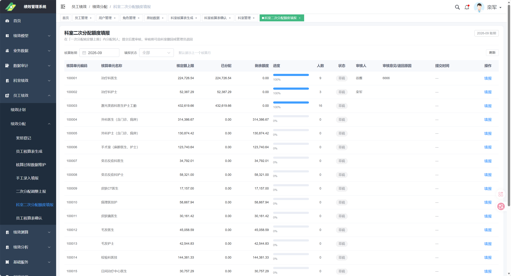
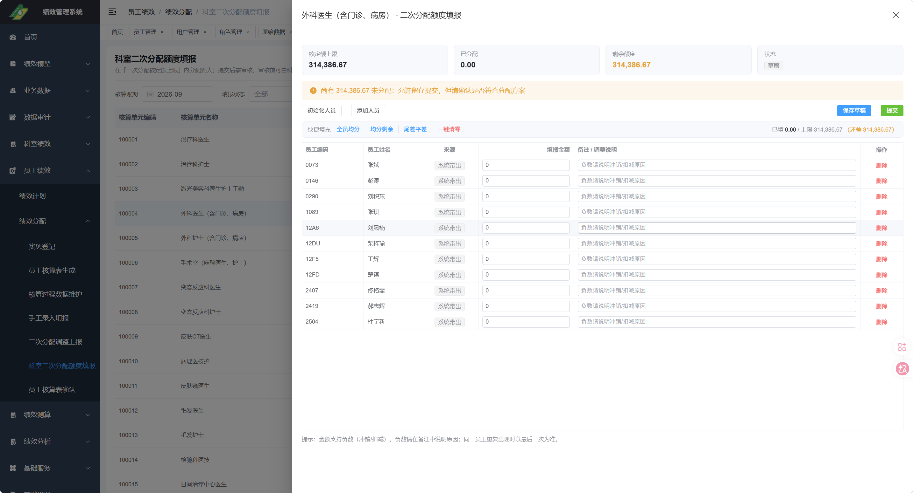
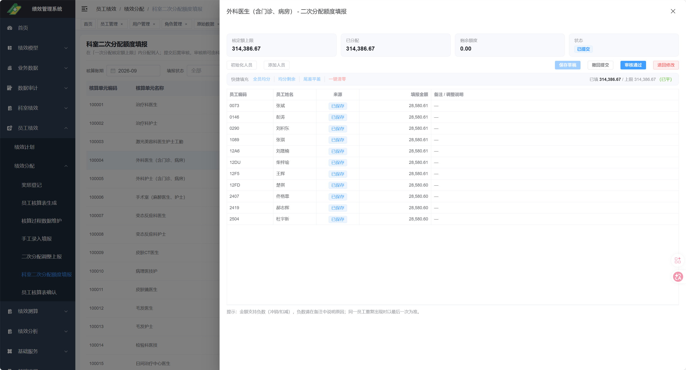

**权限与可见范围**

- 绩效管理员：看到**所有**核算单元，且**草稿 / 已提交 / 已审核各状态都能查看**；
- 核算单元负责人：只看到**自己负责**的核算单元；
- 普通职工：不进入本页面，结果在「二次分配结算分析」中查看本人数据。

**列表字段**：核算单元编码、核算单元名称、核定上限、已分配、剩余额度、进度、人数、状态、审核人、审核意见 / 退回原因、提交时间、操作（填报 / 查看）。

**操作步骤（科室负责人填报）**

| # | 操作 | 入口 | 填写/选择 | 注意事项 |
|---|---|---|---|---|
| 1 | 进入填报页 | 员工绩效 / 绩效分配 / 科室二次分配额度填报 | 选择核算账期（默认上一个核算月） | 可按填报状态筛选 |
| 2 | 打开填报抽屉 | 本科室行【填报】 | — | 已提交 / 已审核的行显示为【查看】 |
| 3 | 确认人员名单 | 抽屉内 | 默认加载本核算单元人员（来源=系统带出） | 名单不全可【初始化人员】或【添加人员】 |
| 4 | 添加人员 | 【添加人员】 | 搜索并多选 | 可添加其他科室人员，由负责人自主决定 |
| 5 | 分配金额 | 明细表「填报金额」 | 手动输入 | 支持负数（冲销 / 扣减），负数须在备注说明原因 |
| 6 | 快捷分配（可选） | 抽屉中部按钮区 | 全员均分 / 均分剩余 / 尾差平差 / 一键清零 | 见下方「快捷填充说明」 |
| 7 | 填写备注 | 「备注 / 调整说明」 | 文字 | 负数、特殊情况必须说明 |
| 8 | 保存草稿 | 【保存草稿】 | — | 可随时保存退出，下次继续 |
| 9 | 提交审核 | 【提交】 | — | 提交后状态变「已提交」，进入管理员审核 |
| 10 | 撤回提交（如需） | 已提交行【撤回提交】 | — | 撤回后回到草稿，可修改后重新提交 |

**操作步骤（绩效管理员审核）**

| # | 操作 | 入口 | 填写/选择 | 注意事项 |
|---|---|---|---|---|
| 11 | 查看填报进度 | 二次分配额度填报列表 | 按账期 / 状态筛选 | 关注未填报、已提交待审核的单元 |
| 12 | 打开抽屉核对 | 目标行【查看】 | — | 核对人员、金额、备注 |
| 13 | 审核通过 | 【审核通过】 | — | 状态变「已审核」，该单元二次分配完成 |
| 14 | 退回修改 | 【退回修改】 | 填写退回原因 | 退回后状态回到「草稿」，**原填报金额保留**，负责人改完重新提交 |
| 15 | 撤销审核（如需） | 已审核行【撤销审核】 | — | 权限可配置：当前仅绩效管理员；撤销后状态直接回到「草稿」 |

**快捷填充说明**

| 按钮 | 作用 |
|---|---|
| 全员均分 | 把核定上限按当前人数平均分配（每人相同） |
| 均分剩余 | 把「剩余额度」平均分给当前人员 |
| 尾差平差 | 除不尽产生的尾差一次性补到第一个员工，保证合计 = 上限 |
| 一键清零 | 所有填报金额归零，重新分配 |

**关键说明**

- 顶部实时显示：核定上限 / 已分配 / 剩余额度 / 状态。
- 明细「来源」列：`系统带出` = 默认名单自动加载；`已保存` = 已保存过的行。
- **未分完允许提交**，但页面会提示「尚有 X 未分配，请确认是否符合分配方案」。
- **同一员工重复出现时，以最后一次为准**（页面底部提示）。
- 金额支持负数：用于冲销 / 扣减，必须在备注注明原因；**负数没有下限**，系统只限制"合计不超过核定上限"，其他不限制。
- **提交后不可编辑**：已提交状态下如需修改，必须先【撤回提交】回到草稿。
- 审核通过即定稿：**只要管理员不【撤销审核】，任何人和科室都不能再改**。
- 审核通过后该单元二次分配完成，结果进入「二次分配结算分析」。
- **退回修改**：退回后状态回到「草稿」，**原填报金额保留**，负责人修改后重新提交。
- **撤销审核**：已审核可撤销，撤销后状态直接回「草稿」，原金额保留；该按钮权限由系统配置，**当前仅配置给绩效管理员**，也可按需下放给科室。

## 2.6 阶段六：结果查询与分析

> 三个分析页面共用同一套数据权限：绩效管理员看全院；核算单元负责人只看自己负责的单元；
> 普通职工仅在「二次分配结算分析」中看本人数据；「科室绩效明细分析」「科室结算总额分析」不开放给普通职工。

### 2.6.1 科室绩效明细分析

- **入口**：`绩效分析 / 科室绩效明细分析`
- **用途**：按「核算项 × 项目」聚合一次分配明细，对比本月 / 上月 / 上年同月，自动计算环比、同比。
- **筛选**：核算账期、核算单元（默认全部授权单元）、项目名称 / 编码。
- **列表字段**：项目编码、项目名称、核算项、核算大类、单元数、本月最终值、上月最终值、环比、上年同月、同比、工作量（本月）、趋势。
- **趋势**：点行末【趋势】查看该项目近 6 个月的最终值与工作量折线。
- **权限**：管理员全部；负责人仅本科室。

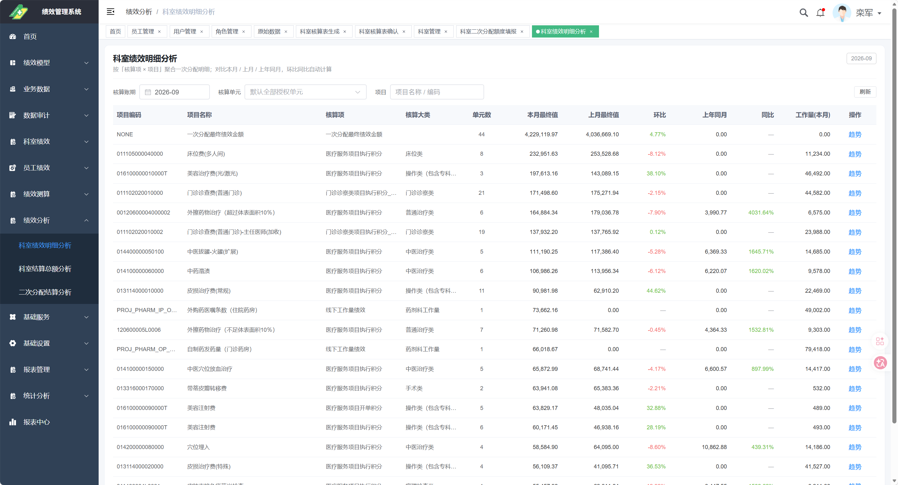
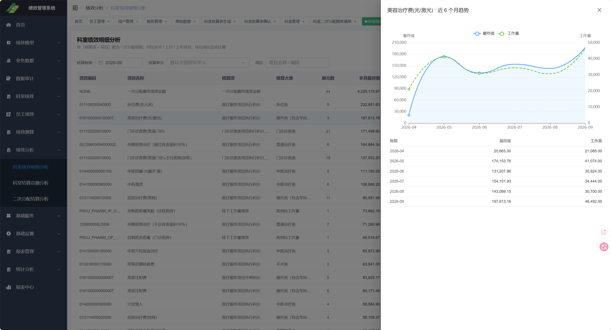

### 2.6.2 科室结算总额分析

- **入口**：`绩效分析 / 科室结算总额分析`
- **数据源**：一次分配结算底账（**期间结账后**才有数据）。
- **指标卡**：期间结算总额、月均资金池、最新账期、较上期。
- **图表**：多核算单元结算总额趋势（按账期范围）。
- **明细字段**：核算单元编码、核算单元名称、核算账期、结算总额（元）、环比增减额、环比增长率、定稿时间、操作（下钻明细）。
- **导出**：右上角【导出 Excel】。
- **权限**：管理员全部；负责人仅本科室。

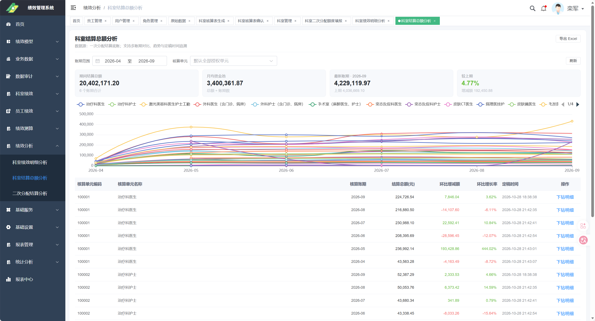

### 2.6.3 二次分配结算分析

- **入口**：`绩效分析 / 二次分配结算分析`
- **用途**：展示手工二次分配的结果，核对「核定上限 vs 实发 vs 结余」。
- **指标卡**：核定上限、二次分配实发、资金池结余、额度使用率。
- **图表**：科室总额趋势、个人趋势、人员分配区间分布（点击柱子可下钻到明细）。
- **明细字段**：核算单元、工号、姓名、核定上限、分配金额、调整说明、状态、审核人、审核时间。
- **权限**：管理员看全部；负责人看本科室整体 + 全员明细；普通职工只看本人。

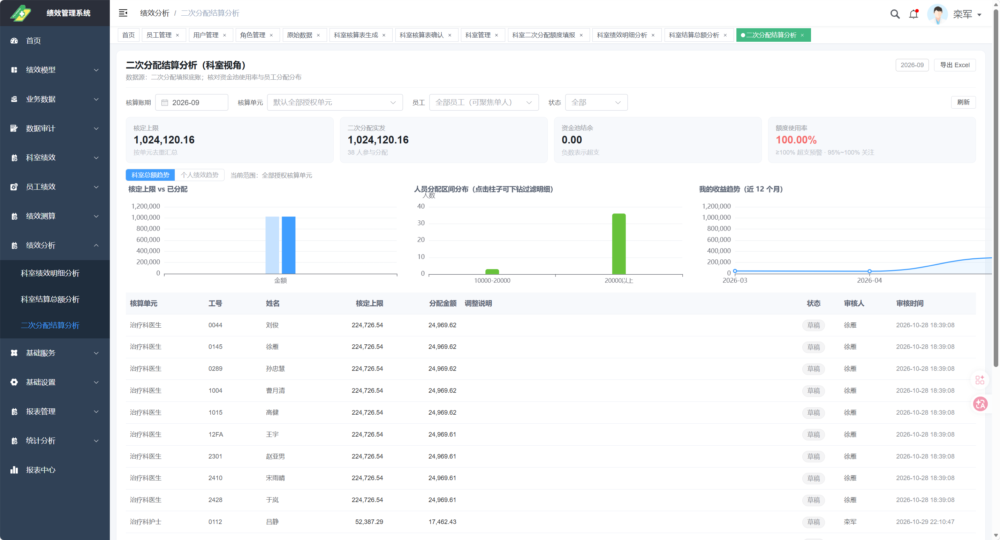

## 2.7 月度时间轴（按医院实际情况）

**基本节奏**

- 每个月核算的是**上个月**的绩效；
- 到了**次月**，上月业务数据一般已可取到，具备开算条件，即可启动当月核算；
- 具体哪天做到哪一步，**取决于医院实际情况**（数据到齐速度、财务/科室排期），不设固定日期。

**参考节奏（可根据医院实际调整）**

| 时点 | 动作 | 责任角色 | 产出 |
|---|---|---|---|
| 次月起 | 确认 HIS 数据已完整同步，拉取状态正常 | 绩效管理员 | 可开算的账期 |
| 数据齐备后 | 维护当月基础数据（岗位系数等） | 绩效管理员 | 计算输入就绪 |
| 随后 | 生成核算表 → 下发 → 科室确认 → 期间结账 | 管理员 + 科室负责人 | 一次分配结果定稿 |
| 结账后 | 科室二次分配填报 → 提交 → 管理员审核 | 科室负责人 + 管理员 | 二次分配结果 |
| 分配完成后 | 查看分析报表、核对差异 | 管理员 / 负责人 | 复核结论 |
| 分配审核通过后 | 结果定稿（审核通过即固定） | 绩效管理员 | 二次分配结果固定，撤销审核前不可修改 |

---

# 第三章 按角色分类的高频操作索引

> 本章只讲"这个功能怎么点"，不展开原理；原理回看第二章对应阶段。

## 3.1 绩效管理员专属

| 功能 | 入口 | 一句话操作 | 常见坑 |
|---|---|---|---|
| 数据拉取（手动补拉） | 业务数据 / 原始数据 | 自动同步失败时点【数据拉取】补拉 | 补拉后回看「拉取状态」 |
| 生成核算表 | 科室绩效 / 绩效分配 / 科室核算表生成 | 定位账期行 →【生成核算表】→ 等「生成状态」成功 | 生成成功 ≠ 已下发 |
| 批量生成核算表 | 同一列表 → 勾选左侧复选框 → 右上角【批量生成核算表】 | 选中多个账期一次生成 | 仅补算多个月时用；日常按月点行末按钮即可 |
| 查看计算结果 | 同上，点「绩效计划名称」进详情 | 看明细各核算项；点「结果值」看计算过程 | 重点核对合计行与异常值 |
| 下发到科室 | 核算表详情 → 勾选核算单元 →【下发到科室】 | 勾选后下发 | 未下发前科室看不见 |
| 二次分配审核 | 员工绩效 / 绩效分配 / 科室二次分配额度填报 | 打开抽屉核对 →【审核通过】或【退回修改】 | 退回需填原因；审核通过后该单元定稿 |
| 查看分析报表 | 绩效分析 / 科室绩效明细分析、科室结算总额分析、二次分配结算分析 | 选账期 / 单元查看，可导出 | 科室结算总额分析需先完成期间结账 |
| 账号与角色管理 | 基础服务 / 员工管理、用户管理、角色管理 | 新增员工自动生成账号；角色配菜单/按钮；用户管理【更多→重置密码】 | 人员编码即账号；一人可多角色；离职在员工管理维护 |
| 期间结账 | 科室绩效 / 绩效分配 / 科室核算表确认 → 详情右上角 | 各科室确认后点【期间结账】定稿 | 仅管理员有权限；重复点结果一致；结账后发现错误需重新生成 → 重新确认 → 重新结账 |

## 3.2 科室负责人专属

| 功能 | 入口 | 一句话操作 | 常见坑 |
|---|---|---|---|
| 查看本科室绩效 | 科室绩效 / 绩效分配 / 科室核算表确认 | 点「绩效计划名称」进详情，点数值看计算过程 | 只能看自己负责的核算单元 |
| 确认核算表 | 同上详情 → 行末【确认】 | 逐行确认本科室结果 | 负责多个核算单元时要分别确认 |
| 撤回确认 | 同上，已确认行【撤回】 | 确认后发现异常先撤回，核对后再确认 | 撤回后需重新确认 |
| 二次分配额度填报 | 员工绩效 / 绩效分配 / 科室二次分配额度填报 | 选账期 →【填报】→ 分配金额 →【提交】 | 合计不得超过核定上限；未分完提交会提示确认 |
| 撤回提交 | 同上，已提交行【撤回提交】 | 撤回后回到草稿，改完重新提交 | 审核通过后不可撤回，需管理员先撤销审核 |
| 查看分析报表 | 绩效分析 / 科室绩效明细分析、科室结算总额分析、二次分配结算分析 | 只看本核算单元 / 本人数据 | 权限由「科室管理」负责人决定 |

## 3.3 普通职工专属

| 功能 | 入口 | 一句话操作 | 常见坑 |
|---|---|---|---|
| 查看本人绩效 | 绩效分析 / 二次分配结算分析 | 登录后只看本人分配明细与趋势 | 数据未生成/未审核时看不到 |

> 菜单找不到时，可直接用系统右上角的搜索功能搜菜单名。

---

# 第四章 常见报错与运维 Q&A

> 写法约定：**现象 → 可能原因 → 处理步骤**；仍然解决不了，按 4.5 的联系方式找人。

## 4.1 计算结果类

### Q1：为什么计算结果为 0，或与以往差别很大？

- **现象**：某个科室的某个核算项数值出现大幅波动，和其他月份差别较大；或者最终绩效金额与以往水平差别较大。
- **可能原因**：① 当期无业务数据；② 指标未配置取数规则；③ 科室未绑定绩效方案；④ 人员未匹配到核算单元；⑤ 计算范围为 0。
- **排查步骤**：按第二章的核算流程从头到尾检查一遍：
  1. 数据是否同步、拉取状态是否成功（2.1）；
  2. 岗位系数、医技护比例等基础数据是否维护完整（2.2）；
  3. 核算表是否生成成功、生成范围是否包含该科室（2.3）；
  4. 点「结果值」看该核算项明细是否有数据、计算过程是否符合预期；
  5. 检查该科室是否已完成确认、结账（2.4），以及二次分配是否已填报提交（2.5）。

### Q2：为什么某科室整月没有数据？

- **可能原因**：① 数据没有同步 / 没有拉取；② 手工导入表或配置表没维护完整。
- **处理**：先到 `业务数据 / 原始数据` 看该表的**拉取状态**与数据条数；再检查相关配置表、导入表是否已维护。

### Q3：重算后金额和上次不一样？

- **原因**：源数据变了——同步的数据、规则表、配置表、手工导入的数据，任意一项变化，重算结果都会变。
- **处理**：核对上述数据是否有变更；如属正常调整，以最新重算结果为准。

## 4.2 导入导出类

### Q4：导入 Excel 提示"字段不匹配"怎么办？

- **原因**：模板列名被改、列顺序变化、存在合并单元格、表头有多余空格。
- **处理**：点【下载模板】拿**最新模板** → 只填数据区 → 保存为 xlsx → 重新导入。
- **填 ID 的规则**：
  - **新增**：不要填 ID 列；
  - **更新**：必须确保 ID 是系统里真实存在、且对应要改的那条数据；填了 ID 且系统存在该 ID，就会覆盖该条数据。
- **注意**：不要删除模板中的隐藏列 / 校验列。

### Q5：导入提示日期或金额格式错误？

- **处理**：日期统一 `yyyy-MM-dd`；金额只填数字，**不带千分位、不带货币符号**；按模板给的格式填。

### Q6：导入成功但列表查不到数据？

- **处理**：先刷新页面（F5 或 Ctrl+R）重新进入查看；再检查查询条件（账期、核算单元、状态等）是否把数据过滤掉了。

## 4.3 权限与登录类

### Q7：登录后看不到某个菜单？

- **处理**：先确认这个人是什么**角色**、该角色是否配置了这个菜单；到 `基础服务 / 角色管理` 给角色勾上菜单后，**重新登录**即可。

### Q8：提示"无该科室权限"？

- **处理**：到 `基础服务 / 科室管理` 看该核算单元的**负责人**是谁；再核对当前员工挂在哪个科室下。两者对不上就会提示无权限。

### Q9：人员离职后账号怎么处理？

- **处理**：`用户管理` 里【更多 → 停用】账号；`员工管理` 里维护离职信息（员工状态、离院时间）。详见 1.4.4。

## 4.4 结账与审核撤回类

### Q10：期间结账后，发现一次分配算错了怎么办？

- **处理路径**：回「科室核算表生成」→ 重新生成核算表 → 科室重新确认 → 管理员重新【期间结账】。
- **注意**：期间结账"点了才更新"，重新结账会以最新一次生成的结果为准；核算表内容没变时重复结账结果一致。

### Q11：二次分配已审核通过，发现要改怎么办？

- **处理路径**：管理员在填报抽屉点【撤销审核】，状态直接回到「草稿」（原金额保留）→ 科室修改 → 重新提交 → 管理员重新审核。
- **权限**：撤销审核当前只配给绩效管理员，可按系统配置下放给科室。

## 4.5 运维处置规范

- **日志**：系统日志在「日志管理」中查看。
- **备份**：系统每天自动备份，由信息科统一管理。
- **故障联系人**：涂嘉苇　17760019761。

---

# 附录

## A. 术语表

| 术语 | 含义 |
|---|---|
| 账期 | 核算年份 + 核算月份，如 2026-10 |
| 一次分配 | 医院 → 核算单元（科室）的绩效核定 |
| 二次分配 | 科室 → 员工的绩效分配 |
| 核算单元 | 绩效核算的最小组织单位（HPS_DEPT_CODE） |
| 核定额上限 | 一次分配给科室的总额，二次分配不得突破 |
| 期间结账 | 把某账期的一次分配结果冻结为结算底账 |

## B. 月度检查清单（可打印）

- [ ] HIS 数据已同步，拉取状态正常
- [ ] 科室增减、人员调岗已维护
- [ ] 医技护执行比例已确认
- [ ] 绩效方案与科室绑定关系已确认
- [ ] 核算表已生成，「生成状态」= 成功
- [ ] 核算表已下发到科室
- [ ] 各科室已在「科室核算表确认」完成确认（全部已确认）
- [ ] 绩效管理员已【期间结账】
- [ ] 各科室二次分配已填报并提交
- [ ] 二次分配已审核通过
- [ ] 分析报表已复核（明细 / 结算总额 / 二次分配）
- [ ] 二次分配已审核通过并定稿

## C. 变更记录

| 版本 | 日期 | 修改人 | 说明 |
|---|---|---|---|
| v1.1 | 2026-10-29 | 涂嘉苇 | 配图结构化：28 处文字占位改为相对路径图片链接，统一存放 `assets/perf-guide/`；新增该目录 README 命名清单与 MarkText 使用说明 |
| v1.0 | 2026-10-29 | 涂嘉苇 | 面向用户定稿：以"阅读指引"替代编写说明；补全 Q1 的现象、原因与排查步骤；去掉升级路径等编写期内容 |
| v0.12 | 2026-10-29 | 涂嘉苇 | 2.3 补取消下发/重新生成规则并去待补；2.4 去反结账待补；删除 3.1 异常数据审计与 3.4 功能索引；Q2–Q9、4.5 运维、术语表补全；变更记录修改人统一 |
| v0.11 | 2026-10-29 | 涂嘉苇 | 2.2 补齐剩余 7 张表口径（工号对照、线下工作量、专项激励、岗位系数、日历、中医病种、点数版本），清空对应待补；补"改基础数据→重算结果会变"说明与统一入口；截图标记增至 28 处 |
| v0.10 | 2026-10-29 | 涂嘉苇 | 1.3 去"待补"标签并修正离职口径；2.2 补真实入口（原始数据→本地文件导入→接口名称→详情页按钮）与行内操作；医技护比例、奖惩、院外项目三表去掉无意义待补并补业务口径 |
| v0.9 | 2026-10-29 | 涂嘉苇 | 补 1.1 系统定位与结果去向（只取数、不回写、仅导出、不发放、未对接财务）；1.3 科室负责人基础档案权限与超管口径；1.4.4 离职两步处理与数据保留说明；2.1 重点表精简为 6 张、补手动补拉/幂等/状态含义；2.7 去掉固定日期 |
| v0.8 | 2026-10-29 | 涂嘉苇 | 补 1.4 账号与角色（员工管理新增→自动生成账号、用户管理重置密码、角色管理配菜单/按钮与成员、离职在员工管理维护）；2.3 补【批量生成核算表】适用场景与【批量重新分配】不展开说明；3.1 快捷索引同步 |
| v0.7 | 2026-10-29 | 涂嘉苇 | 撤销审核改为直接回「草稿」；补"提交后不可编辑、须先撤回"与"负数无下限、仅限总额不超上限"；删除不存在的归档概念（审核通过即定稿，撤销审核前不可改）；明确两张科室分析报表不对普通职工开放 |
| v0.6 | 2026-10-29 | 涂嘉苇 | 按业务确认修正：退回修改→草稿且保留金额；新增撤销审核（当前仅管理员，可配置下放）；管理员可见各状态草稿；清空未上线的申诉内容；2.7 月度时间轴改为"次月 1 日数据定稿即开算、具体按医院实际" |
| v0.5 | 2026-10-29 | 涂嘉苇 | 新增 2.5 二次分配填报（人员加载/添加、手动与快捷分配、草稿/提交/撤回、审核通过/退回）、2.6 三张分析报表；2.4 补确认状态与撤回、结账幂等及"重新生成→重新确认→重新结账"闭环；流程图改六阶段；权限矩阵与快捷索引同步；截图标记增至 20 处 |
| v0.4 | 2026-10-29 | 涂嘉苇 | 新增 2.4 科室确认与期间结账（数据权限=科室负责人、逐单元确认、管理员结账），原申诉/归档顺延为 2.5；流程图改为五阶段；补 3 处截图标记；更新 3.1/3.2 快捷索引 |
| v0.3 | 2026-10-29 | 涂嘉苇 | 补 2.1 手动【数据拉取】；2.2 导入方式改为系统实际按钮（单行新增 / 更新导入 / 全量覆盖）并修正表名；2.3 补「生成核算表 → 详情核对 → 结果值 → 下发到科室」全流程与 3 处截图标记；同步更新 3.1 快捷索引 |
| v0.2 | 2026-10-29 | 涂嘉苇 | 补充 2.1 HIS 数据同步（8 张重点表）与 2.2 月度维护清单（10 张表 + 逐表说明），新增 7 处截图标记 |
| v0.1 | 2026-10-29 | 涂嘉苇 | 建立章节骨架，待逐章补充正文 |
